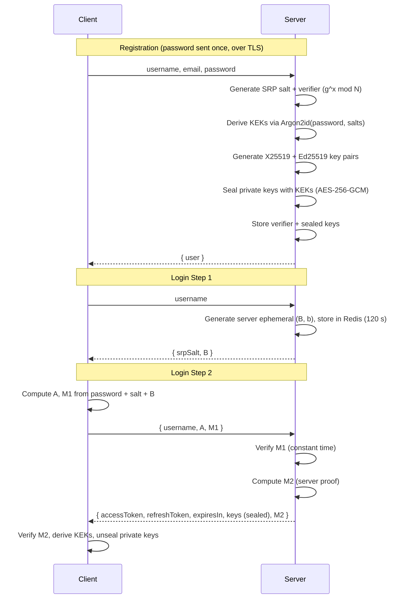
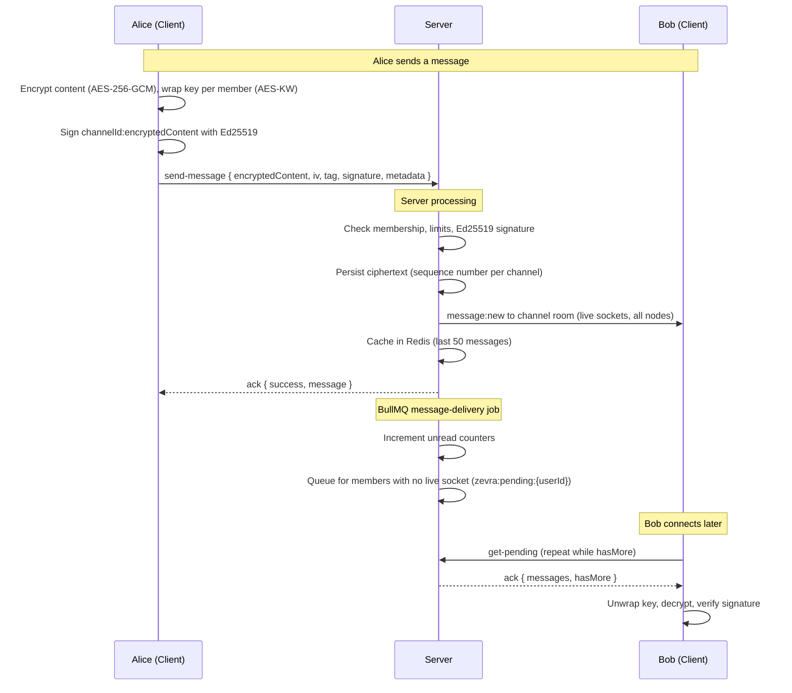
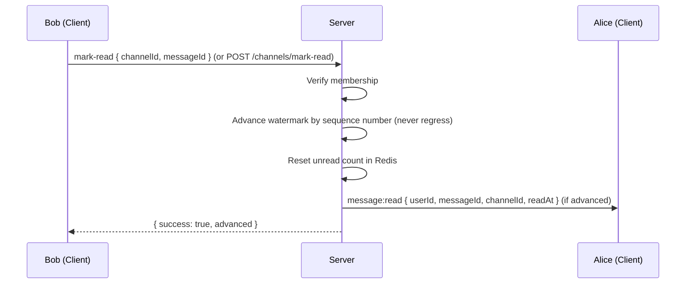
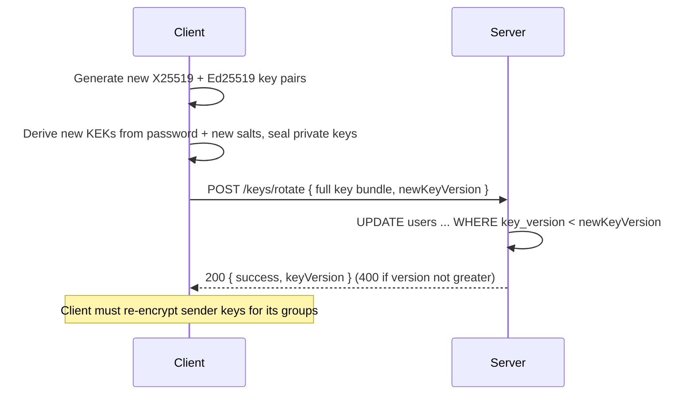
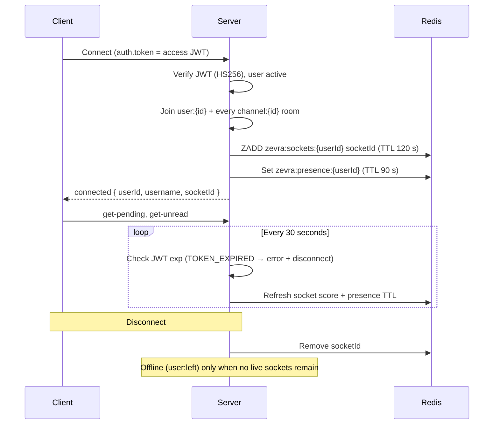
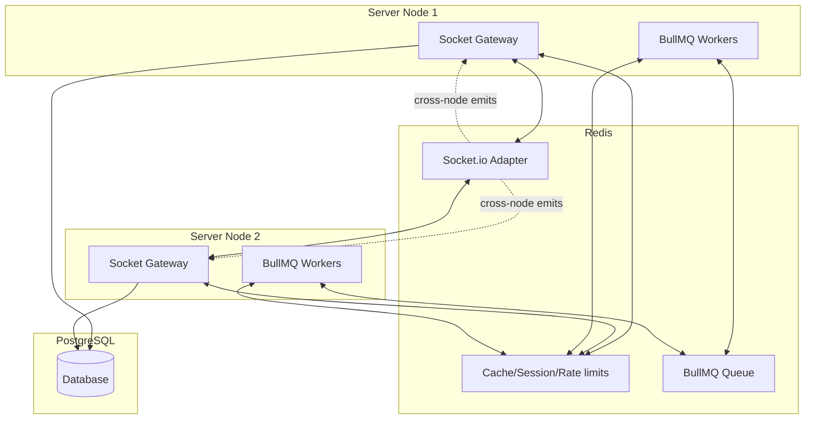
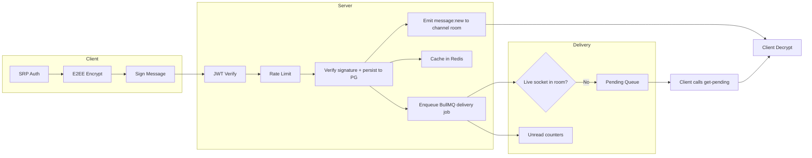

<p align="center">
  <h1 align="center">ZEVRA</h1>
  <p align="center"><b>Z</b>ero-knowledge <b>E</b>vents <b>V</b>erified <b>R</b>ealtime <b>A</b>rchitecture</p>
  <p align="center">End-to-End Encrypted Messaging Server</p>
</p>

<p align="center">
  <a href="https://github.com/BazilSuhail/ZEVRA-Server">
    
  </a>
  <a href="https://github.com/BazilSuhail/ZEVRA">
    
  </a>
</p>

<p align="center">
  
  
  
  
  
  
</p>

---

## About

ZEVRA is an end-to-end encrypted messaging server. Message content is encrypted on the client; the server stores ciphertext, IVs, auth tags and signatures. Private keys are stored only in sealed form (encrypted with an Argon2id-derived key).

It is **not fully zero-knowledge** today: at registration the client sends the password to the server (over TLS), and the server generates the user's key pairs and seals them. After registration, login uses SRP and the password is not sent again. Attachments are stored unencrypted on Cloudinary. The server also sees metadata (who talks to whom, when, message sizes, reactions).

**API reference: [API.md](API.md).** It is authoritative; the files in `docs/` are older and may disagree.

## Features & Functionality

### Core Capabilities

- **SRP-6a login** — RFC 5054 2048-bit group, SHA-256. The server stores a verifier, not a password hash. Unknown usernames get a decoy response, so login/start does not reveal whether an account exists.
- **Registration (server-side keys)** — the server receives the password once, derives the SRP verifier, generates X25519 + Ed25519 key pairs and seals them with Argon2id-derived KEKs. Moving key generation to the client is an open product decision.
- **End-to-End Encryption** — AES-256-GCM message content with per-member AES-KW key envelopes (X25519-derived); Ed25519 signatures over `${channelId}:${encryptedContent}`, verified by the server on send and by clients on receive.
- **Tokens** — 15-minute JWT access tokens (`JWT_ACCESS_TTL`), 7-day single-use refresh tokens stored as SHA-256 hashes. Logout revokes all refresh tokens.
- **Real-Time Messaging** — Socket.IO with room-based broadcasting, typing indicators (auto-stop after 6 s) and presence.
- **Multiple sessions** — a user can be connected from several devices/tabs at once. There is no forced disconnect; the user goes offline when the last socket leaves.
- **Offline Message Queue** — messages for recipients with no live socket are queued in Redis (`zevra:pending:{userId}`, 7 days). Clients fetch them with `get-pending` after connecting; the server does **not** push them automatically.
- **Read Receipts** — sequence-based watermark that never moves backwards; socket and REST mark-read both reset unread counters and emit `message:read`.
- **Multi-Node Support** — Socket.IO Redis adapter; BullMQ `message-delivery` workers run on any node.
- **Rate Limiting** — atomic Redis counters. HTTP: 300/min per user (or IP); register 5/min/IP; login start/finish 10/min per IP and per username; refresh 30/min/IP; uploads 20/min/user. Socket: 20 messages/s, 10 typing events/s, 30 fetches/s, 120 connections/min per IP.
- **Key Rotation** — `POST /keys/rotate` applies the full new key bundle synchronously, guarded by key version.
- **Sender Keys** — per-group, per-epoch encrypted keys for each member.
- **Graceful Degradation** — Redis-backed rate limits fail open; the delivery queue falls back to inline delivery.
- **Emoji Reactions** — one reaction per user per message; stored in plaintext (server-visible).
- **File & Image Uploads** — Cloudinary, type detected from file bytes, 10 MB limit. Files are **not** end-to-end encrypted.
- **Health checks** — `GET /health` (liveness) and `GET /health/ready` (DB + Redis).

### Technical Stack

| Component | Technology | Purpose |
|-----------|------------|---------|
| Runtime | Bun | TypeScript execution |
| Framework | NestJS 11 | Modules, DI, guards, pipes |
| Database | PostgreSQL | Persistent storage |
| ORM | Drizzle ORM | Queries and SQL migrations (`bun run db:migrate`) |
| Cache | Redis | Socket registry, presence, channel member cache, message cache, unread counters, typing, pending queue, SRP state, rate limits, call state, Socket.IO adapter, BullMQ |
| Job Queue | BullMQ | 1 queue: `message-delivery` (offline queueing + unread counters) |
| Realtime | Socket.IO v4 | WebSocket gateway with Redis adapter |
| File Storage | Cloudinary | Image and file uploads (unencrypted) |
| Auth | SRP-6a + JWT | Password proof + 15 min access tokens + 7 d single-use refresh tokens |
| Crypto | Argon2id + X25519 + Ed25519 + AES-256-GCM | KDF, key exchange, signing, authenticated encryption |
| Security | Helmet + Redis rate limiter | HTTP headers, request limits |

### Workflow Diagrams

#### Authentication (SRP-6a)



#### End-to-End Encrypted Messaging



#### Read Receipts



#### Key Rotation



No client currently performs rotation (the web keys page shows key status only).

#### Sessions and Heartbeat (multiple sockets per user)



#### Multi-Node Architecture



#### System Overview



## Quick Start

```bash
# Install
bun install

# Configure: create .env with at least
#   DATABASE_URL=postgres://...
#   JWT_SECRET=<32+ random characters>
#   REDIS_URL=redis://...
# Full list in API.md → Environment variables.

# Apply migrations (do NOT use drizzle-kit push)
bun run db:migrate

# Run
bun run start:dev
```

Server runs at `http://localhost:3000` (`PORT`). Checks: `bun run typecheck`, `bun run build`, `bun test`.

`drizzle-kit push` must not be used on an existing database: migration `0003` hashes existing refresh tokens into `token_hash`, and `push` would drop the column instead.

## Documentation

**[API.md](API.md) is the authoritative reference** (endpoints, socket events, error codes, Redis keys, env vars, deploy). The files below predate the fix pass; where they differ from API.md, API.md is correct.

| Document | Description |
|----------|-------------|
| [API.md](API.md) | Current REST + Socket.IO API, errors, rate limits, Redis keys, env vars, migrations |
| [Architecture](docs/architecture.md) | System overview, module map (older) |
| [Database](docs/database.md) | Schema reference (older) |
| [REST API](docs/api-rest.md) | HTTP endpoints (older; see API.md) |
| [WebSocket API](docs/api-websocket.md) | Socket.IO events (older; see API.md) |
| [Redis](docs/redis.md) | Redis usage (older; see API.md) |
| [BullMQ](docs/bullmq.md) | Job queues (older; only `message-delivery` remains) |
| [E2EE](docs/e2ee.md) | SRP-6a auth, key management, sender keys |
| [Security](docs/security.md) | Rate limiting, Helmet, JWT lifecycle (older) |
| [Deployment](docs/deployment.md) | Setup and production build (older) |

## Security Properties and Limits

| Threat | Protection | Limit |
|--------|------------|-------|
| Database breach | Message content is ciphertext; private keys are sealed with Argon2id-derived keys; SRP verifier, not a password hash; refresh tokens stored hashed | Metadata, reactions and Cloudinary attachment URLs are readable; a weak password can be brute-forced offline against the verifier/sealed keys |
| Malicious or compromised server | Server never receives plaintext messages after registration | The server receives the password and generates the keys at registration, so a compromised server at that moment can capture them |
| MITM | TLS + E2EE | No out-of-band key verification (safety numbers) |
| Stolen device | Mobile keys in the OS secure store; access tokens in memory only | Logout revokes refresh tokens; there is no remote device revocation |
| Sender forgery | Ed25519 signature over `channelId:encryptedContent`, checked by server and clients | |
| Credential stuffing / enumeration | Rate limits per IP and per username; decoy SRP responses for unknown users | |
| Forward secrecy | Not provided — no ratchet; long-term X25519 keys wrap message keys | |

## License

MIT
